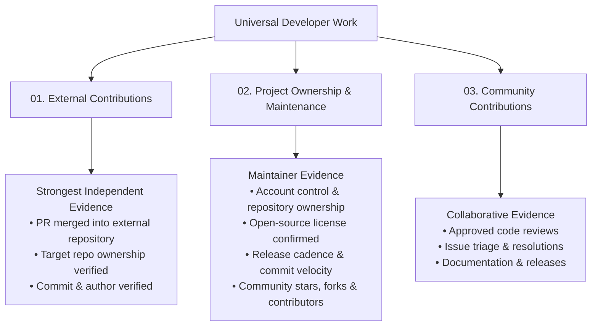

# SIGNET (formerly SoulPR) — Evidence-First Contribution Credentials

> **Your work is your mark. Turn eligible merged open-source contributions, maintained projects, and community reviews into permanent, verifiable Soulbound credentials on NEAR Protocol.**

[](https://testnet.nearblocks.io)
[](./contract/near)
[](./backend)
[](./frontend)
[](https://walletconnect.com)
[](LICENSE)

**Live Deployed Application**: [https://soul-pr-git-main-moizzs-projects.vercel.app/](https://soul-pr-git-main-moizzs-projects.vercel.app/)

---

## 1. Executive Overview

**SIGNET** is an evidence-first contribution credential protocol for individual open-source developers. Its mission is to transform authentic open-source engineering work into structured, auditable contribution records and non-transferable (**Soulbound**) on-chain credentials on **NEAR Protocol**.

SIGNET is not an NFT marketplace, a speculative badge game, or a subjective scoring platform. It operates on a disciplined chain of cryptographic custody:

$$\text{GitHub Source Facts} \longrightarrow \text{Evidence Snapshot (SHA-256)} \longrightarrow \text{Deterministic Assessment} \longrightarrow \text{Developer Approval} \longrightarrow \text{NEAR Attestation} \longrightarrow \text{Public Verification}$$

### Core Protocol Principles
- **Evidence First**: All claims link directly to authoritative GitHub API source records, immutable content digests, and canonical smart contract state.
- **Universal Developer Recognition**: Not every developer only contributes to external repositories. SIGNET recognizes external pull requests, self-maintained open-source projects, and collaborative code reviews.
- **Developer Agency**: No credential is ever issued without explicit developer review of the evidence snapshot and NEAR wallet signing authorization.
- **Transparent Claim Boundaries**: Credentials state precisely what was verified (e.g. repository ownership, open-source license, code review sign-off) and explicitly note boundaries to never confuse creator activity with external peer review.
- **Truthful States**: Unconfirmed, pending, or sample items are never represented as live issued credentials.

---

## 2. The Three Pillars of Contribution

Open source is built by creators, contributors, and maintainers. SIGNET evaluates work according to three distinct verification models:



### 01. External Contributions
- **Evidence Strength**: Strongest independent evidence.
- **Description**: A developer contributes code to someone else's open-source repository.
- **Verification Engine**: Validates PR author identity, target repository ownership, merged state (`merged === true`), merge commit SHA, and maintainer reviewer approval.
- **Example**: Submitting a performance refactor to `facebook/react` or `near/nearcore` and having it merged by maintainers.

### 02. Project Ownership and Maintenance
- **Evidence Strength**: Maintainer contribution & creator stewardship.
- **Description**: A developer builds, ships, and maintains their own open-source tool, library, or infrastructure.
- **Verification Engine**: Verifies developer control of the connected GitHub account, validates public repository ownership, checks for an approved open-source license (MIT, Apache-2.0, BSD, etc.), inspects commit cadence, audits public releases, and tallies community signals (stars, forks, open issues).
- **Claim Boundaries**: Proves creator authority, public code publication, and maintenance activity without asserting external peer review.
- **Example**: Creating and maintaining an open-source CLI, developer SDK, or framework.

### 03. Community Contributions
- **Evidence Strength**: Collaborative evidence.
- **Description**: Activities essential to open-source health other than writing merged code.
- **Verification Engine**: Audits code review approvals on pull requests, issue reporting and triage, documentation improvements, and release management.
- **Example**: Reviewing and approving external contributions or resolving critical bug issues.

---

## 3. The Evidence Classification System

SIGNET credentials feature a standardized evidence classification taxonomy indicating how the underlying work was substantiated:

| Classification | Meaning & Scope |
| :--- | :--- |
| **`INDEPENDENTLY MERGED`** | Contribution accepted and merged into an independently maintained repository. |
| **`MAINTAINER VERIFIED`** | Project maintainer has attested to the contribution or review action. |
| **`GITHUB VERIFIED`** | GitHub API source records authenticate and substantiate the activity. |
| **`SELF-MAINTAINED`** | Developer controls, owns, and maintains the open-source repository with an audited license. |
| **`COMMUNITY VERIFIED`** | Independent community activity (stars, forks, external contributors) supports the claim. |

---

## 4. Technical Architecture

```
                                 ┌────────────────────────┐
                                 │   GitHub REST & Graph  │
                                 │ (PRs, Repos, Reviews)  │
                                 └───────────┬────────────┘
                                             │
                             Webhook Event or Direct URL Import
                                             │
                                             ▼
┌────────────────────────────────────────────────────────────────────────────────┐
│                         Backend Service (Node.js / Express)                    │
│                                                                                │
│   ├── 1. Ingestion: Extract canonical facts, commit SHA, and license data     │
│   ├── 2. Evidence Snapshot: Canonicalize & compute SHA-256 provenance digest   │
│   ├── 3. Deterministic Assessment: Rule-by-rule eligibility verification       │
│   ├── 4. Developer Approval: Record auditable approval bound to snapshot hash  │
│   └── 5. NearChainService: Dispatch & monitor NEAR Protocol transaction        │
└────────────────────────────┬───────────────────────────────────┘
                                             │
                             near-api-js / Function Call
                                             │
                                             ▼
┌────────────────────────────────────────────────────────────────────────────────┐
│                      NEAR Protocol Smart Contract (Rust)                       │
│                                (NEAR Testnet)                                  │
│                                                                                │
│   ├── Soulbound Token (SBT): Non-transferable contribution attestation record  │
│   ├── Idempotency Guard: sha256(repo || prNumber || contributor || commitSha)  │
│   ├── Enumeration Views: nft_token, nft_tokens_by_owner, nft_total_supply      │
│   └── Verification State: Immutable receipt anchored to evidence digest        │
└────────────────────────────┬───────────────────────────────────┘
                                             │
                               Direct NEAR RPC Query
                                             │
                                             ▼
┌────────────────────────────────────────────────────────────────────────────────┐
│                   Frontend Workspace & Registry (React / Vite)                 │
│                                                                                │
│   ├── Overview (/dashboard): Full-width command center & 3-pillar engine       │
│   ├── Contributions (/contributions): Multi-pillar registry & URL verifier     │
│   ├── Evidence Dossier (/contributions/:id): Rule breakdown & claim boundaries │
│   ├── My Credentials (/credentials): Rotating 3D Holographic SBT Shelf         │
│   ├── Contributor Explorer (/contributors): Live GitHub handle & wallet lookup │
│   ├── Verification (/verification): Public lookup & 4-layer inspector         │
│   └── WalletConnect v2 Modal: Real camera-scannable QR & browser extension probe│
└────────────────────────────────────────────────────────────────────────────────┘
```

---

## 5. Information Architecture & Workspaces

The platform provides a responsive, high-density workspace shell for developers alongside public verification pages:

| Route | Purpose | Access |
| :--- | :--- | :--- |
| **`/`** | Product landing page, Ophanim gyroscope animation, & philosophy | Public |
| **`/dashboard`** | Full-width command center, 4 KPI metric tiles, & 3-pillar verification hub | Authenticated |
| **`/contributions`** | Structured contributions registry with 3-pillar filters & import | Authenticated |
| **`/contributions/:id`** | Comprehensive evidence dossier, claim boundaries, & real 3D SBT showcase | Authenticated |
| **`/credentials`** | Confirmed Soulbound Token shelf with interactive 3D rotating hologram | Authenticated |
| **`/contributors`** | Contributor Intelligence Explorer: live GitHub & NEAR wallet lookups | Authenticated |
| **`/verification`** | Public credential lookup & 4-layer audit entry | Public |
| **`/verify/:credentialId`**| Live public verification page rendering real 3D SBT & git tree data | Public |
| **`/verify/sample`** | Illustrative sample demonstrator showcase | Public |
| **`/link-wallet`** | Universal NEAR WalletConnect v2 modal & browser extension pairing | Authenticated |
| **`/settings`** | GitHub permissions, NEAR account link, and sync preferences | Authenticated |

---

## 6. Smart Contract Specifications (`contract/near`)

- **Language / Framework**: Rust 2021 with `near-sdk v5.7.0`
- **Target Network**: NEAR Protocol Testnet (`testnet`)
- **Compilation Target**: `wasm32-unknown-unknown`
- **Security**: Non-transferable token standard with zero write scopes for non-owners.
- **Core Functions**:
  - `init(owner: AccountId, backend_minter: AccountId)`: Initializes the contract with an administrative owner and authorized backend minter.
  - `mint(contributor, repo, pr_number, pr_title, github_username, merge_commit_sha, merge_timestamp)`: Mints an immutable contribution receipt. Guarded by an idempotency hash: `sha256(repo || pr_number || contributor || merge_commit_sha)`.
  - `is_minted(repo, pr_number, contributor, merge_commit_sha) -> bool`: Checks whether a contribution has already been recorded on-chain.
  - `nft_token(token_id: u64) -> Option<Attestation>`: Reads full attestation metadata for a given token ID.
  - `nft_tokens_by_owner(owner: AccountId) -> Vec<u64>`: Returns all token IDs owned by a specific NEAR account.
  - `nft_total_supply() -> u64`: Total minted attestations.

---

## 7. WalletConnect v2 & Injected Extension Engine

Connecting your NEAR wallet is seamless across desktop and mobile devices:
- **Authentic Scannable QR Matrix**: Dynamic WalletConnect v2 pairing URI encoded into a real, high-contrast, camera-scannable QR matrix generated via `qrcode`.
- **Active Browser Extension Detection**: Automatically detects installed browser wallet extensions:
  - **Sender Wallet** (`window.sender`, `window.near`)
  - **Meteor Wallet** (`window.meteor`, `window.meteorWallet`)
  - **HERE Wallet** (`window.here`, `window.hereWallet`)
  - **Nightly Wallet** (`window.nightly?.near`)
  - **MyNearWallet** (direct Web standard portal)
- **Instant Pairing Confirmation**: Injected extensions are highlighted with `✓ DETECTED IN BROWSER` for one-click pairing.

---

## 8. 3D Holographic Soulbound Tokens (SBT)

Every confirmed credential renders an interactive, physics-based 3D holographic credential rotating on its own axis:
- **Card Front**: Gold scalloped Signet medallion, high-resolution QR verification code, developer handle, repository, contribution title, merge timestamp, and `Cryptographically Verified on NEAR Blockchain` pill.
- **Card Back**: Technical `Protocol Provenance Manifest` with canonical SHA-256 evidence digest, smart contract ID (`signet.testnet`), on-chain transaction hash, schema specification (`signet.evidence.v1.0`), and security level rating.

---

## 9. Local Development Setup

### Prerequisites
- **Node.js**: `>= 22.16.0`
- **Rust & Cargo**: Stable toolchain with `wasm32-unknown-unknown` target:
  ```bash
  rustup target add wasm32-unknown-unknown
  ```
- **NEAR Account**: A valid testnet account from [MyNearWallet](https://testnet.mynearwallet.com/), [Meteor Wallet](https://wallet.meteorwallet.app/), or [HERE Wallet](https://herewallet.app/).

---

### Step 1: Rust Smart Contract (`contract/near`)

```bash
cd contract/near

# Verify formatting
cargo fmt -- --check

# Run test suite
cargo test

# Build release WebAssembly artifact
cargo build --target wasm32-unknown-unknown --release
```

---

### Step 2: Backend Service (`backend`)

1. Copy `.env.example` to `backend/.env`:
   ```bash
   cd backend
   cp .env.example .env
   ```

2. Configure environment variables in `backend/.env`:
   ```env
   PORT=3001
   NODE_ENV=development
   CHAIN_PROVIDER=near

   SESSION_SECRET=your_32_character_random_session_secret
   FRONTEND_URL=http://localhost:5173

   # GitHub OAuth credentials
   GITHUB_CLIENT_ID=your_github_client_id
   GITHUB_CLIENT_SECRET=your_github_client_secret
   GITHUB_REDIRECT_URI=http://localhost:3001/auth/github/callback
   GITHUB_WEBHOOK_SECRET=your_webhook_secret

   # NEAR Protocol Testnet Configuration
   NEAR_NODE_URL=https://rpc.testnet.near.org
   NEAR_NETWORK_ID=testnet
   NEAR_CONTRACT_ID=soulpr.testnet
   NEAR_BACKEND_ACCOUNT_ID=soulpr-backend.testnet
   NEAR_BACKEND_PRIVATE_KEY=ed25519:your_backend_private_key_base58
   NEAR_MINT_STORAGE_DEPOSIT=1250000000000000000000
   ```

3. Install dependencies, build, and start the development server:
   ```bash
   npm install
   npm run build
   npm test
   npm run dev
   ```

---

### Step 3: Frontend Workspace (`frontend`)

1. Copy `.env.example` to `frontend/.env`:
   ```bash
   cd frontend
   cp .env.example .env
   ```

2. Configure variables in `frontend/.env`:
   ```env
   VITE_BACKEND_URL=http://localhost:3001
   VITE_NEAR_ENABLED=true
   VITE_NEAR_NETWORK_ID=testnet
   VITE_NEAR_NODE_URL=https://rpc.testnet.near.org
   VITE_NEAR_CONTRACT_ID=soulpr.testnet
   ```

3. Run the development server:
   ```bash
   npm install
   npm run dev
   ```

4. Open **[http://localhost:5173](http://localhost:5173)** in your browser.

---

## 10. Independent Verification & Telemetry

Every credential issued by SIGNET can be audited by any reviewer:
1. **Public Verification Portal**: `https://soul-pr-git-main-moizzs-projects.vercel.app/verify/:credentialId`
2. **NEAR Blockchain Explorer**: `https://testnet.nearblocks.io/txns/:txHash`
3. **GitHub Pull Request & Git Tree**: Direct verification against the immutable commit SHA on GitHub.

---

## 11. License & Legal Terms

Copyright (c) 2026 SIGNET / SoulPR. **All Rights Reserved.**

This repository and its source code are proprietary and confidential. Unauthorized copying, modification, distribution, sublicensing, or commercial deployment is strictly prohibited. See [LICENSE](LICENSE) for full legal terms.
